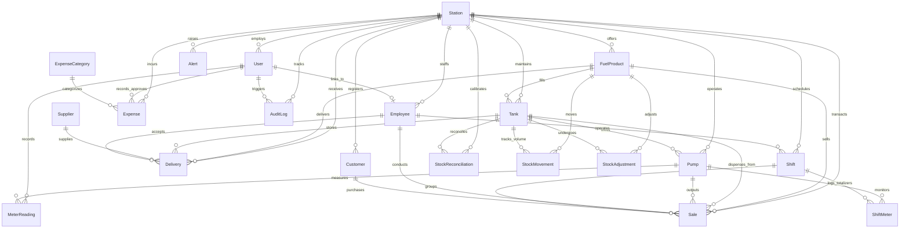

# Database Architecture & Entity-Relationship Model

**Project:** Fuel Station Management System — PetroFlow Enterprise  
**Database Engine:** PostgreSQL (with SQLite zero-config dev option)  
**ORM:** Prisma ORM  

---

## 1. Entity-Relationship Diagram (ERD)

The following Mermaid ER Diagram models the complete relational schema with primary keys, foreign keys, cardinality, and constraints.



---

## 2. Relational Entity Dictionary

| Entity | Primary Key | Key Foreign Keys | Purpose & Business Rules |
| :--- | :--- | :--- | :--- |
| **Station** | `id` (UUID) | None | Supports multi-station architecture. Uniquely identified by `code` (e.g., `STN-001`). |
| **User** | `id` (UUID) | `stationId` → Station | Application user accounts. Secure Argon2id/bcrypt hashes. Role: `ADMIN`, `MANAGER`, `ATTENDANT`. |
| **Employee** | `id` (UUID) | `stationId` → Station, `userId` → User | Station workforce roster. Links to shifts and recorded transactions. |
| **FuelProduct** | `id` (UUID) | `stationId` → Station | Fuel grades (RON 91 Petrol, BS-VI Diesel, XP95 Premium). Stores retail rate & wholesale cost. |
| **Tank** | `id` (UUID) | `stationId`, `fuelProductId` | Underground fuel reservoirs. Tracks `capacityLiters`, `currentStockLiters`, and safe thresholds. |
| **Pump** | `id` (UUID) | `stationId`, `tankId` | Dispenser island nozzles. Connected to dedicated supply tank. Monitors cumulative lifetime volume. |
| **MeterReading** | `id` (UUID) | `stationId`, `pumpId`, `recordedByUserId` | Physical totalizer counter records. Classifications: `OPENING`, `CLOSING`, `AUDIT`, `RESET`. |
| **Supplier** | `id` (UUID) | None | Wholesale petroleum marketing companies (IOCL, BPCL, HPCL) with GSTIN registration. |
| **Delivery** | `id` (UUID) | `stationId`, `supplierId`, `destinationTankId` | Bulk tanker receipts. **Rule:** Does NOT increment inventory until confirmed by authorized staff. |
| **Sale** | `id` (UUID) | `stationId`, `pumpId`, `fuelProductId`, `tankId`, `attendantId` | Point-of-sale dispensing transaction. Unique `transactionNumber`. Locked via ACID transaction. |
| **StockMovement**| `id` (UUID) | `stationId`, `tankId`, `fuelProductId` | Complete volume ledger tracking additions (Delivery, Positive Adj) and subtractions (Sales, Negative Adj). |
| **StockAdjustment**| `id` (UUID)| `stationId`, `tankId`, `fuelProductId`, `userId` | Authorized manual volume calibrations with categorized reason codes (Evaporation, Calibration, Spillage). |
| **Shift** | `id` (UUID) | `stationId`, `employeeId` | Operational staff shifts (`MORNING`, `EVENING`, `NIGHT`). Calculates expected cash vs physical cash. |
| **ShiftMeter** | `id` (UUID) | `shiftId`, `pumpId` | Captures opening & closing totalizer values per dispenser during an attendant shift. |
| **Expense** | `id` (UUID) | `stationId`, `categoryId`, `recordedByUserId`, `approvedByUserId` | Station operating overheads (Electricity, Generator Fuel, Calibration, Lease). Requires approval. |
| **Customer** | `id` (UUID) | `stationId` | Commercial fleets and retail consumers. Tracks credit limits and accrued balances. |
| **StockReconciliation**| `id` (UUID)| `stationId`, `tankId`, `userId` | Authoritative stock reconciliation formula evaluations comparing ledger expected stock against physical dip. |
| **Alert** | `id` (UUID) | `stationId` | Stateful operational alerts (`LOW_STOCK`, `CAPACITY_NEAR_FULL`, `CASH_VARIANCE`, `METER_DISCREPANCY`). |
| **AuditLog** | `id` (UUID) | `stationId`, `userId` | Immutable, append-only security journal capturing actor, action, before/after JSON diffs, and IP addresses. |

---

## 3. High-Value SQL Queries for Practical Exam & Viva Voce

During your practical examination and viva voce, examiners frequently ask for raw SQL equivalents of application logic. Here are the three most important queries:

### Query 1: Daily Sales & Revenue Breakdown by Fuel Grade
```sql
SELECT 
    f.name AS fuel_product,
    f.fuel_type,
    COUNT(s.id) AS total_transactions,
    ROUND(SUM(s.quantity_liters)::numeric, 2) AS total_liters_sold,
    ROUND(SUM(s.total_amount)::numeric, 2) AS total_revenue,
    ROUND(SUM(s.quantity_liters * f.cost_price)::numeric, 2) AS cost_of_goods_sold,
    ROUND(SUM(s.total_amount - (s.quantity_liters * f.cost_price))::numeric, 2) AS gross_profit
FROM sales s
JOIN fuel_products f ON s.fuel_product_id = f.id
WHERE s.payment_status = 'COMPLETED'
  AND s.created_at >= CURRENT_DATE
  AND s.created_at < CURRENT_DATE + INTERVAL '1 day'
GROUP BY f.id, f.name, f.fuel_type
ORDER BY total_revenue DESC;
```

### Query 2: Current Tank Inventory Balance & Utilization Percentage
```sql
SELECT 
    t.tank_number,
    f.name AS fuel_name,
    t.capacity_liters,
    t.current_stock_liters,
    ROUND(((t.current_stock_liters / t.capacity_liters) * 100)::numeric, 1) AS utilization_percent,
    t.low_stock_threshold_liters,
    CASE 
        WHEN t.current_stock_liters <= t.low_stock_threshold_liters THEN 'CRITICAL_LOW'
        WHEN t.current_stock_liters >= (t.capacity_liters * 0.95) THEN 'NEAR_FULL'
        ELSE 'OPTIMAL'
    END AS operational_status
FROM tanks t
JOIN fuel_products f ON t.fuel_product_id = f.id
WHERE t.active = true
ORDER BY utilization_percent ASC;
```

### Query 3: Shift Cash Handover Reconciliation & Variance
```sql
SELECT 
    sh.id AS shift_id,
    e.full_name AS attendant_name,
    sh.shift_name,
    sh.start_time,
    sh.end_time,
    sh.opening_cash,
    COALESCE(SUM(s.total_amount), 0) AS recorded_cash_sales,
    (sh.opening_cash + COALESCE(SUM(s.total_amount), 0)) AS expected_cash,
    sh.actual_cash AS physical_cash_handover,
    sh.actual_cash - (sh.opening_cash + COALESCE(SUM(s.total_amount), 0)) AS cash_variance
FROM shifts sh
JOIN employees e ON sh.employee_id = e.id
LEFT JOIN sales s ON s.shift_id = sh.id AND s.payment_method = 'CASH' AND s.payment_status = 'COMPLETED'
WHERE sh.id = 'YOUR_SHIFT_UUID_HERE'
GROUP BY sh.id, e.full_name, sh.shift_name, sh.start_time, sh.end_time, sh.opening_cash, sh.actual_cash;
```
